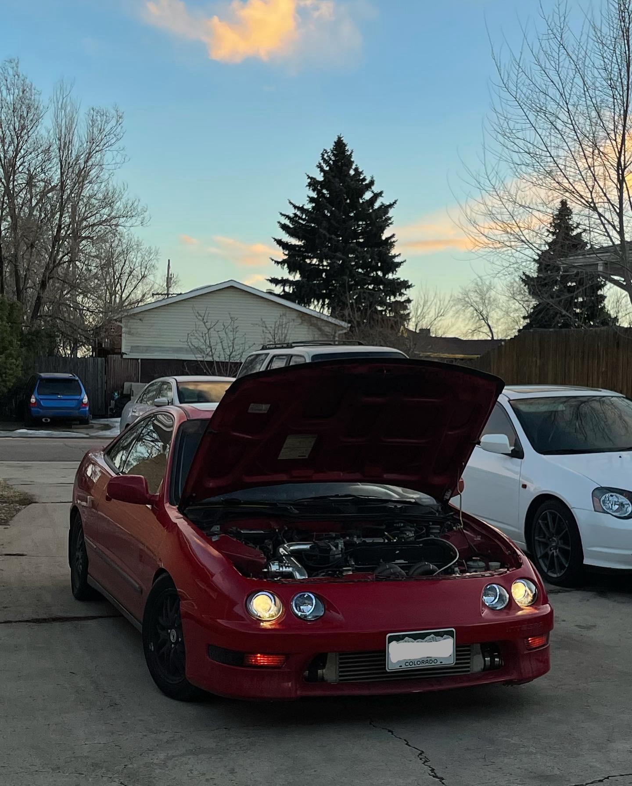
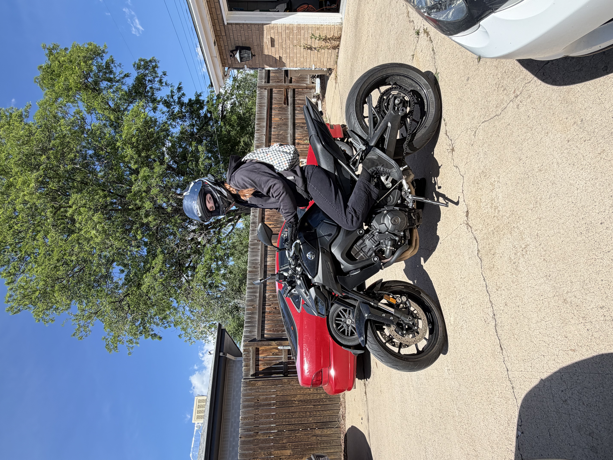
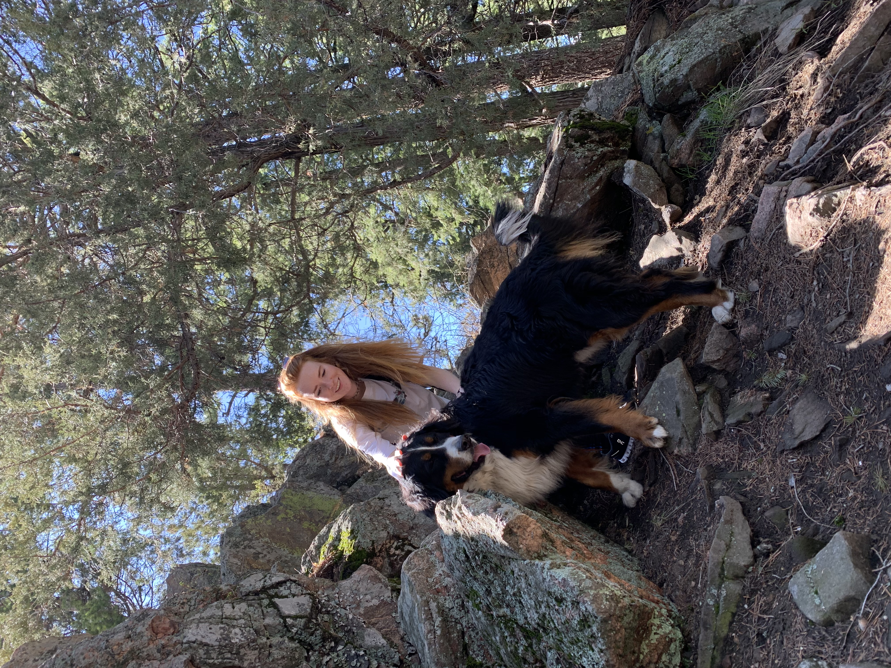
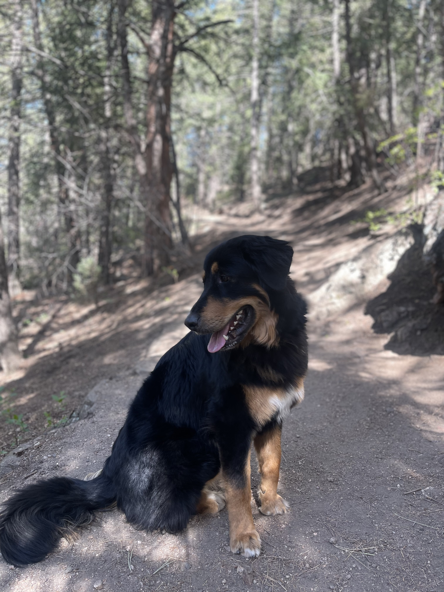
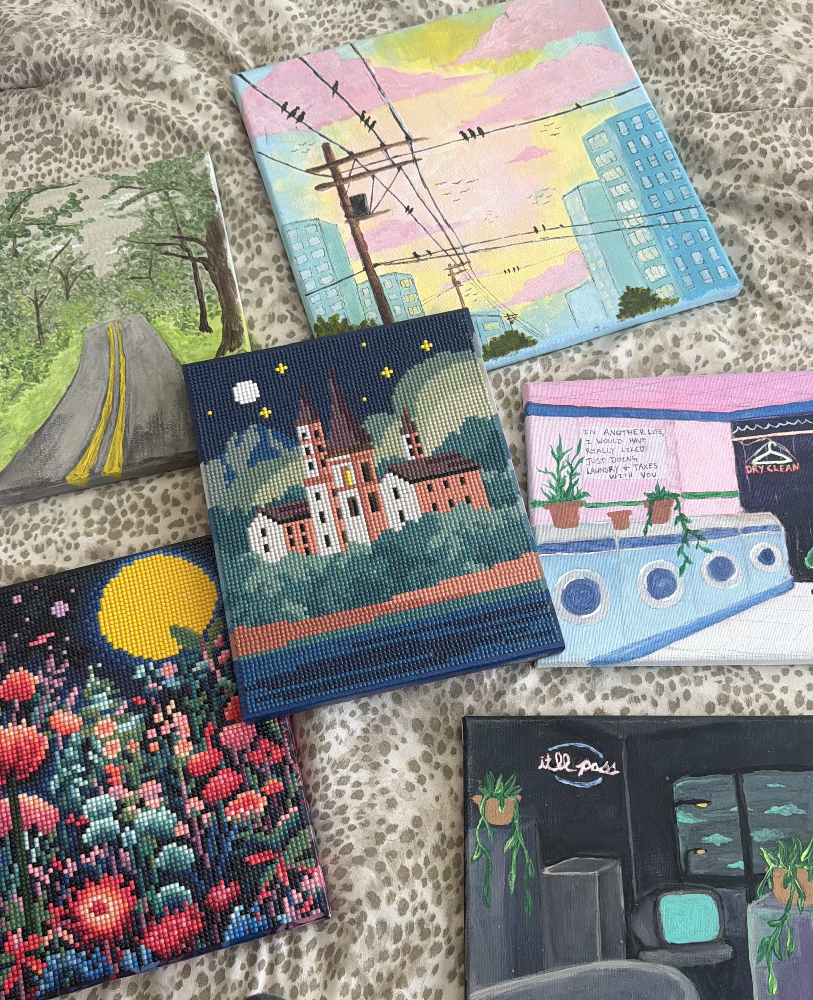
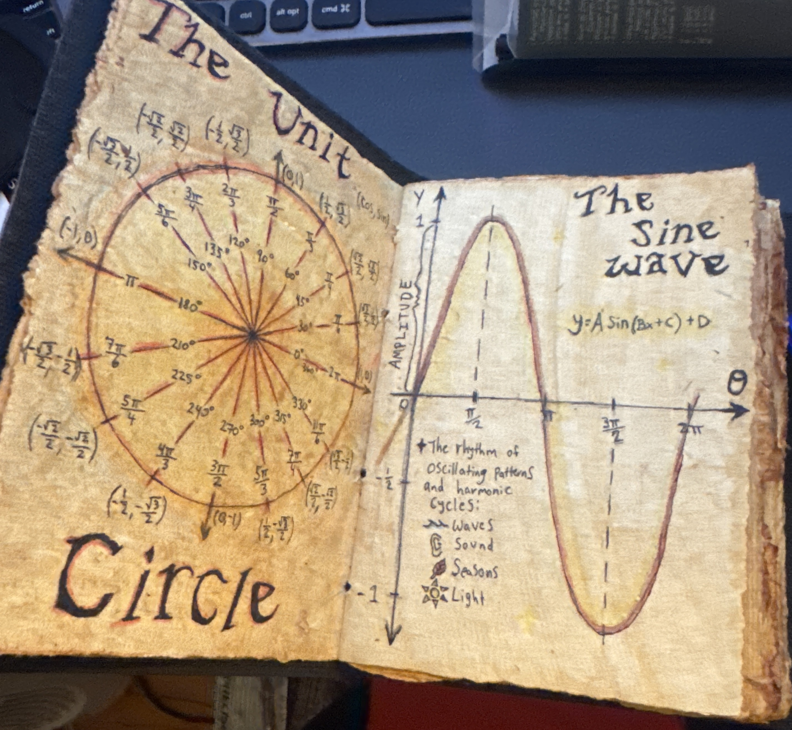
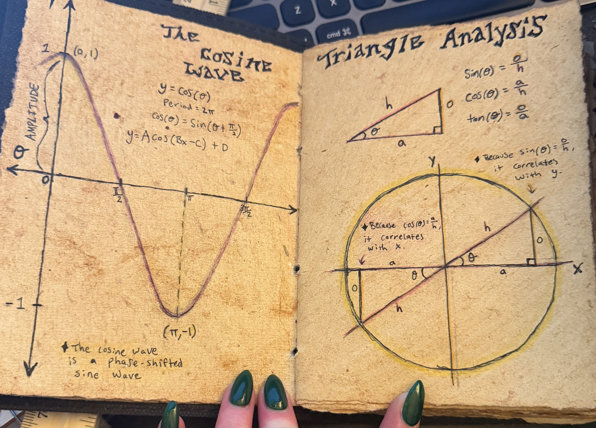

## Motorcycles and Cars

Ever since I was a small child, I've had an affinity for powersports. The first time I got pulled over, I was 12 years old- on a jet ski.

I have been riding street bikes for 6 years. There is little that makes me feel more alive. I have a 2019 Yamaha MT-09. I also have a turboed 1995 Acura Integra. I've enjoyed the process of learning to work on and maintain vehicles I love. Despite loving both, my heart (and wallet) are partial to motorcycles. 

{width="270"}
{width="250px"}

## Hiking with my dog

I begged for a dog my entire childhood. Every birthday candle, dandelion, letter to Santa- I wished for a dog. When I was 14, my dad finally surprised us with a Bernese Mountain Dog. His name was Toby. He loved being alive. He made people love being alive. Most of my free time was spent in the mountains with Toby.

{width="250px" fig-align="center"}

When I was 21 I got a puppy of my own- half Bernese Mountain Dog. I figured even if she would only ever be half as great as Toby, she'd still be pretty damn good.

Toby passed away when I was 24. I'd never been more heartbroken. No one had ever loved me so unconditionally; nothing had ever been so pure. I'd been convinced that goodness could save him from his own mortality. I never fathomed living in a world without Toby. 

I've now spent 6 years with my Bernese Mountain Dog/German Shepherd mix named Hazel. She’s big and silly. Sometimes she looks at me and I see Toby. It reminds me to appreciate the slice of time we get to exist in together. So I try to spend my free moments outside with her, hiking and exploring the mountains- they don't call them mountain dogs for nothing.

{width="250px" fig-align="center"}

## Arts and Crafts

I think life is nothing without creativity. I enjoy making things with my hands, whether it be painting, drawing, or crocheting.

{width="230" fig-align="center"}

One of my favorite projects was combining my love for mathematics and art into a "math bible." I've always been partial to trigonometry, fascinated by the way it kept showing up in everything I learned. I thought it was beautiful, exciting, and worth illustrating. I'm excited to fill the remaining pages as I learn and discover more mathematical concepts worth falling in love with.

{width="270"}
{width="300px"}